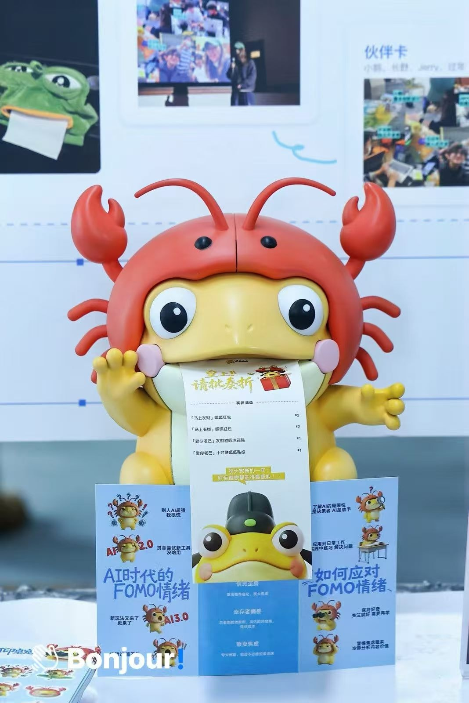

# Hi！ 👋

I'm **Jerry (Jiarui Li / 李佳睿)**, a final-year Software Engineering student.

- 🪼 **Engineer @ [AirJelly](https://airjelly.ai)** — a desktop AI companion for work context and proactive assistance.
- 💻 Full-stack development: desktop apps, backend infrastructure, and developer tools.
- 🧩 Open-source contributor to **[Hermes Agent](https://github.com/NousResearch/hermes-agent)** — [Weixin media delivery](https://github.com/NousResearch/hermes-agent/commit/498fc6780ebc21805bcd26f6de842d0aa722f66d).

🌐 [hedgeho9.cn](https://hedgeho9.cn)

## Experience

- **[JiliGuagua / 叽里呱呱](https://www.rtecommunity.dev/physical-ai-camp/cohort/jiligugu)** · Former co-founder · **2026.01–2026.05**  
  AI printing companion; **1M+ impressions across platforms**.
- **[juzi.bot](https://www.juzi.bot/)** · AI Agent Development Intern · **2025.09–2025.12**  
  Agent evaluation, development, and proactive interaction.

Photos, events & coverage

**AirJelly · [airjelly.ai](https://airjelly.ai)**

AirJelly remembers your work across apps and proactively helps with tasks, follow-ups, and daily summaries. My work spans desktop features, backend services, observability, and evaluation infrastructure.

**JiliGuagua / 叽里呱呱**

An AI desktop companion that turns spoken ideas into printed task cards and notes.

**Award:** Gold Award in the AI × Game track at the Hangzhou Global Hackathon (January 2026).

**Event participation:** ByteDance, Tencent, Alibaba, Apple, Xiaohongshu, Nokia and AWS events; the Global Developer Conference, World Artificial Intelligence Conference (WAIC), and [LET'S VISION 2026](https://letsvision.swiftgg.team/zh/booths).

**Media coverage:** CCTV, Zhejiang TV, [People's Daily](https://paper.people.com.cn/rmrb/pc/content/202605/11/content_30156053.html), Hong Kong Wen Wei Po, [City Express](https://mdaily.hangzhou.com.cn/dskb/2026/02/11/article_detail_2_20260211B022.html), and Shizilukou (十字路口).

**juzi.bot**

Worked on agent evaluation, conversational behavior, and agent development, while exploring proactive agent interactions.

## Awards

## Stack

