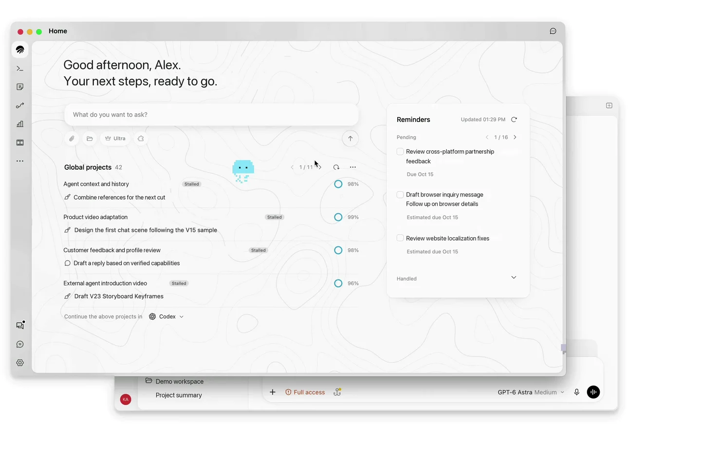
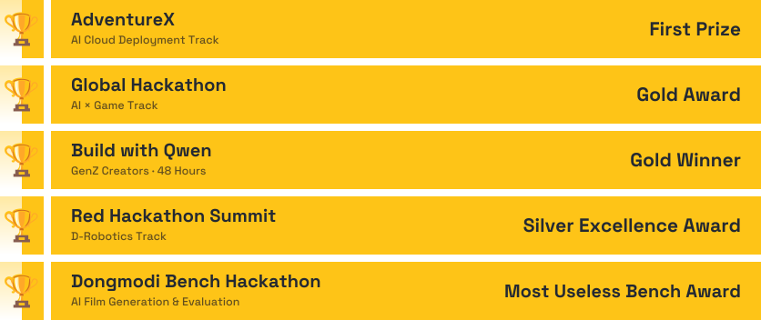

### Hi, I'm Hedgeho9 👋

I'm **Jerry (Jiarui Li / 李佳睿)**, a final-year Software Engineering student.

I build full-stack products — desktop apps, backend services, and the tooling and infrastructure behind them.

[Website](https://hedgeho9.cn) · [GitHub](https://github.com/hedgeho9X) · Chengdu, China

**Now**

- 🪼 Engineer at **AirJelly** — building desktop features, backend services, observability, billing, and evaluation infrastructure.

**Focus**

Full-stack product engineering · Desktop systems · Reliability & observability · AI agents & evaluation

**Experience & selected work**

#### [JiliGuagua / 叽里呱呱](https://www.rtecommunity.dev/physical-ai-camp/cohort/jiligugu) · 2026.01–2026.05

Former co-founder of an AI desktop companion that turns spoken ideas into printed task cards and notes. Reached **1M+ impressions across platforms**.

**Award:** Gold Award in the AI × Game track at the Hangzhou Global Hackathon (January 2026).

**Event participation:** ByteDance, Tencent, Alibaba, Apple, Xiaohongshu, Nokia and AWS events; the Global Developer Conference, World Artificial Intelligence Conference (WAIC), and [LET'S VISION 2026](https://letsvision.swiftgg.team/zh/booths).

**Media coverage:** CCTV, Zhejiang TV, [People's Daily](https://paper.people.com.cn/rmrb/pc/content/202605/11/content_30156053.html), Hong Kong Wen Wei Po, [City Express](https://mdaily.hangzhou.com.cn/dskb/2026/02/11/article_detail_2_20260211B022.html), and Shizilukou (十字路口).

#### [juzi.bot](https://www.juzi.bot/) · 2025.09–2025.12

AI Agent Development Intern. Worked on agent evaluation, conversational behavior, and agent development, while exploring proactive agent interactions.

**Awards**

Selected as one of 200 builders worldwide for the Red Hackathon Summit.

---

**Stack**

*Testing / exploring:* 
